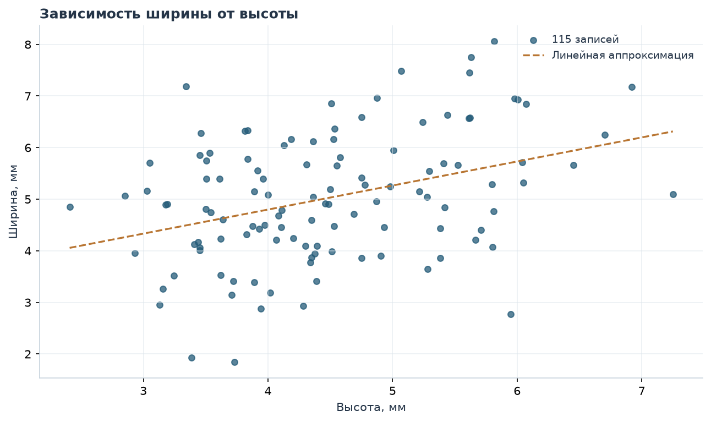
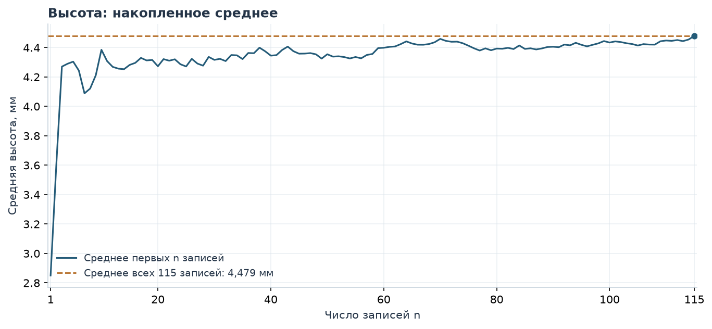
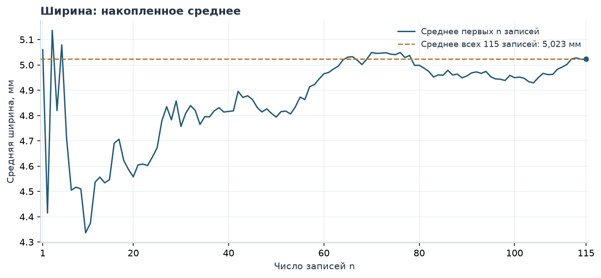
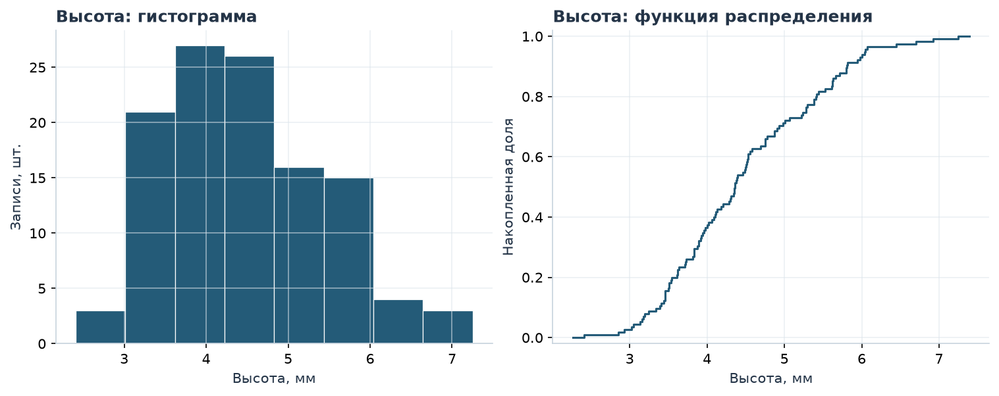
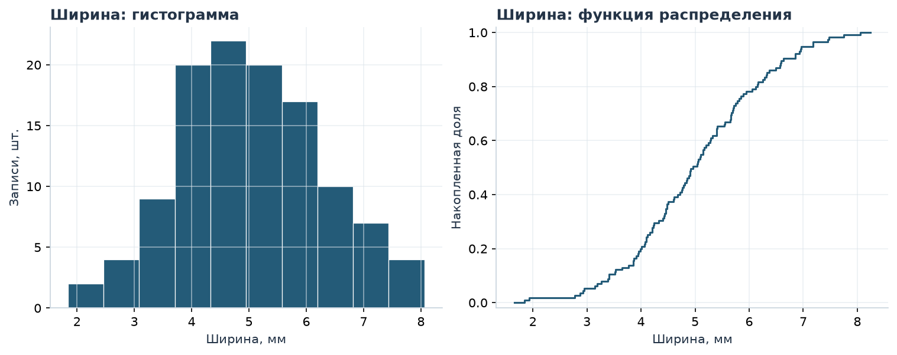
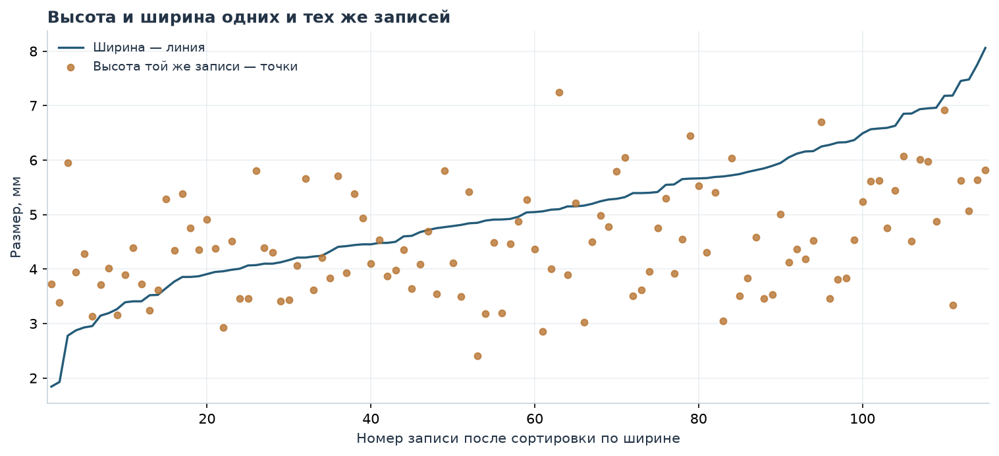

# Лабораторная работа 1. Анализ высоты и ширины рукописного написания a

Дополнительное задание

Выполнили:  
Янковская Катерина  
Шерстнев Игорь

## Содержание

- [Данные](#data)
- [Анализ независимости величин](#independence)
- [EDA](#eda)
- [Вывод](#conclusion)
- [Источники](#sources)

## Данные

Был взят датасет, собранный в ходе анализа рукописного написания латинской буквы a. В исследовании участвовали 60 человек, каждый из которых дважды повторил своё написание (всего 120 записей). В качестве рассматриваемых величин были взяты высота и ширина буквы.

Пропусков и нулевых размеров в датасете не было, выбросы были обработаны, после их удаления работу мы продолжили со 115 записями. Границы Тьюки (1,5 IQR) были рассчитаны один раз по исходным 120 записям отдельно для двух размеров: для высоты — 1,510–7,602 мм, для ширины — 1,596–8,419 мм. Удалялась целая запись, если хотя бы один размер выходил за свою границу. Всего исключено 5 записей: 3 по высоте и 2 по ширине. [Очищенные данные](data/cleaned_glyphs.csv).

## Анализ независимости и случайности величин

Высота и ширина буквы были определены как разность крайних координат из всех точек и штрихов.

Размеры зависят от почерка, также у одного и того же участника при повторении размеры различаются.

Ниже представлена зависимость ширины буквы от высоты на основе полученных данных.

Точки показывают 115 оставшихся записей. Прямая $W=0,466H+2,936$ описывает их общую линейную тенденцию. Проверка ранговой связи по 60 средним авторов с учётом площадки и числа повторов дала $r=0,199$, $p=0,1399$; 95%-й bootstrap-интервал — [-0,048; 0,448]. При уровне 0,05 значимая связь не подтвердилась; независимость величин этим не доказана. После фильтра у 55 авторов осталось по два повторения, у 5 — по одному.

**Рисунок 1. Ширина в зависимости от высоты**

Также определим корректность величины нашей выборки. Построим график зависимости среднего от размера выборки.

Максимальный размер здесь равен 115 — числу оставшихся записей. Для двух графиков использован один и тот же перемешанный порядок записей. Пунктиром отмечено среднее всего очищенного набора. При $n=115$ накопленное среднее совпадает с ним по построению; сам график не доказывает достаточность объёма выборки.

**Рисунок 2. Накопленное среднее высоты**

**Рисунок 3. Накопленное среднее ширины**

## EDA

### Высота

Средняя высота — 4,479 мм, медиана — 4,362 мм, стандартное отклонение — 0,974 мм. Ниже приведены остальные характеристики и распределение высоты.

**Таблица 1. Характеристики высоты**

<table border="1" class="dataframe">
<thead>
<tr style="text-align: right;">
<th></th>
<th>Показатель</th>
<th>Высота H</th>
</tr>
</thead>
<tbody>
<tr>
<th>0</th>
<td>Объём, записей</td>
<td>115</td>
</tr>
<tr>
<th>1</th>
<td>Сумма, мм</td>
<td>515,135</td>
</tr>
<tr>
<th>2</th>
<td>Среднее, мм</td>
<td>4,479</td>
</tr>
<tr>
<th>3</th>
<td>Медиана, мм</td>
<td>4,362</td>
</tr>
<tr>
<th>4</th>
<td>Минимум, мм</td>
<td>2,408</td>
</tr>
<tr>
<th>5</th>
<td>Максимум, мм</td>
<td>7,250</td>
</tr>
<tr>
<th>6</th>
<td>Стандартное отклонение, мм</td>
<td>0,974</td>
</tr>
<tr>
<th>7</th>
<td>Выборочная дисперсия, мм²</td>
<td>0,948</td>
</tr>
<tr>
<th>8</th>
<td>5-й перцентиль, мм</td>
<td>3,150</td>
</tr>
<tr>
<th>9</th>
<td>1-й квартиль, мм</td>
<td>3,727</td>
</tr>
<tr>
<th>10</th>
<td>3-й квартиль, мм</td>
<td>5,258</td>
</tr>
<tr>
<th>11</th>
<td>95-й перцентиль, мм</td>
<td>6,043</td>
</tr>
<tr>
<th>12</th>
<td>Квартильный размах, мм</td>
<td>1,531</td>
</tr>
<tr>
<th>13</th>
<td>Все моды, мм</td>
<td>3,454; 4,750</td>
</tr>
</tbody>
</table>

**Рисунок 4. Распределение высоты**

### Ширина

Средняя ширина — 5,023 мм, медиана — 4,960 мм, стандартное отклонение — 1,238 мм. Ниже приведены остальные характеристики и распределение ширины.

**Таблица 2. Характеристики ширины**

<table border="1" class="dataframe">
<thead>
<tr style="text-align: right;">
<th></th>
<th>Показатель</th>
<th>Ширина W</th>
</tr>
</thead>
<tbody>
<tr>
<th>0</th>
<td>Объём, записей</td>
<td>115</td>
</tr>
<tr>
<th>1</th>
<td>Сумма, мм</td>
<td>577,615</td>
</tr>
<tr>
<th>2</th>
<td>Среднее, мм</td>
<td>5,023</td>
</tr>
<tr>
<th>3</th>
<td>Медиана, мм</td>
<td>4,960</td>
</tr>
<tr>
<th>4</th>
<td>Минимум, мм</td>
<td>1,842</td>
</tr>
<tr>
<th>5</th>
<td>Максимум, мм</td>
<td>8,059</td>
</tr>
<tr>
<th>6</th>
<td>Стандартное отклонение, мм</td>
<td>1,238</td>
</tr>
<tr>
<th>7</th>
<td>Выборочная дисперсия, мм²</td>
<td>1,532</td>
</tr>
<tr>
<th>8</th>
<td>5-й перцентиль, мм</td>
<td>3,087</td>
</tr>
<tr>
<th>9</th>
<td>1-й квартиль, мм</td>
<td>4,145</td>
</tr>
<tr>
<th>10</th>
<td>3-й квартиль, мм</td>
<td>5,799</td>
</tr>
<tr>
<th>11</th>
<td>95-й перцентиль, мм</td>
<td>7,026</td>
</tr>
<tr>
<th>12</th>
<td>Квартильный размах, мм</td>
<td>1,655</td>
</tr>
<tr>
<th>13</th>
<td>Все моды, мм</td>
<td>3,408; 3,855; 4,099; 4,211; 4,454; 5,395</td>
</tr>
</tbody>
</table>

**Рисунок 5. Распределение ширины**

Для сравнения двух размеров записи упорядочены по ширине. Линия показывает ширину, точки — высоту той же записи. При равной ширине порядок задают автор и номер повторения; высоты отдельно не сортируются.

**Рисунок 6. Высота и ширина упорядоченных записей**

## Вывод

В очищенном наборе ширина в среднем больше высоты: 5,023 против 4,479 мм. Разброс ширины также больше: стандартное отклонение 1,238 против 0,974 мм. Статистически значимая ранговая связь с учётом площадки и числа повторов не подтвердилась. Утверждать независимость величин по этой проверке нельзя.

## Источники

1. [UJI Pen Characters (Version 2), UCI](https://archive.ics.uci.edu/dataset/177/uji+pen+characters+version+2), [DOI 10.24432/C5FG8S](https://doi.org/10.24432/C5FG8S), CC BY 4.0. Использованы записи латинской буквы a. В документации заданы масштабы 100 ink units/мм для UJI и 152 ink units/мм для UPV; размеры переведены в миллиметры экранной системы планшета.
2. Llorens D. et al. [The UJIpenchars Database: a Pen-Based Database of Isolated Handwritten Characters](https://aclanthology.org/L08-1467/), LREC, 2008.
3. [NIST: Box Plot](https://www.itl.nist.gov/div898/handbook/eda/section3/boxplot.htm) — правило границ Тьюки для обработки выбросов.
4. [SciPy: permutation_test](https://docs.scipy.org/doc/scipy/reference/generated/scipy.stats.permutation_test.html) — перестановочная проверка и Monte Carlo поправка.

[Исходные измерения](data/glyphs.csv) · [Описание данных](data/provenance.json)
