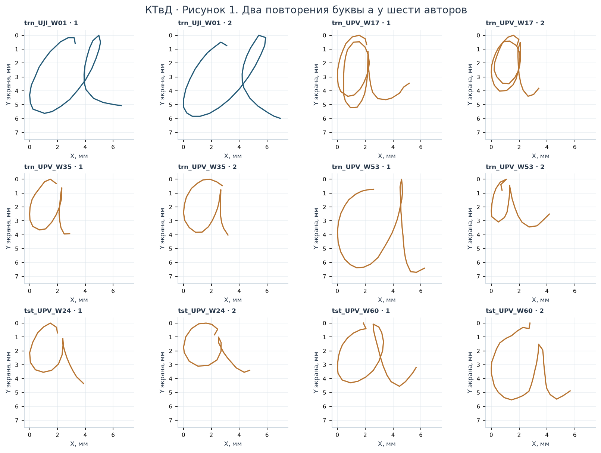
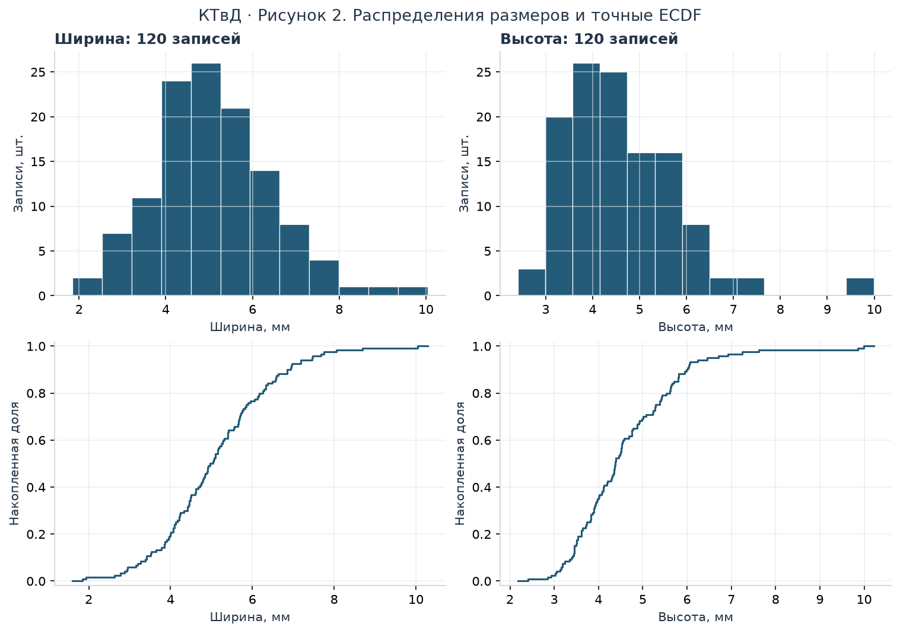
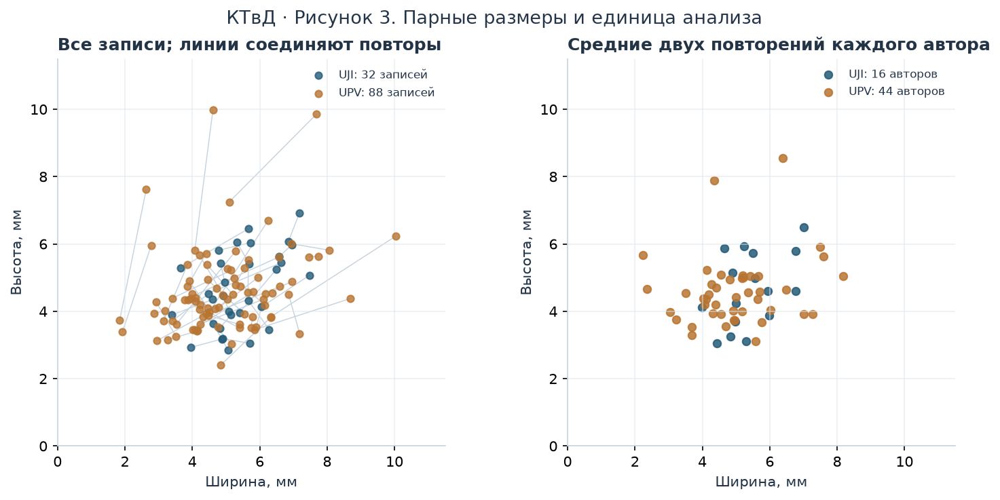
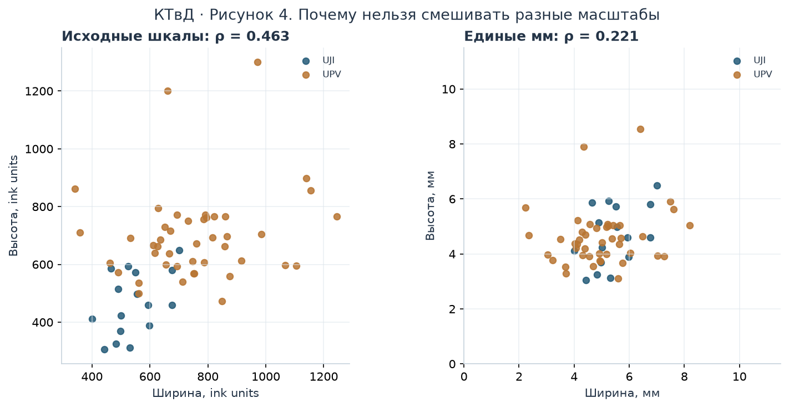
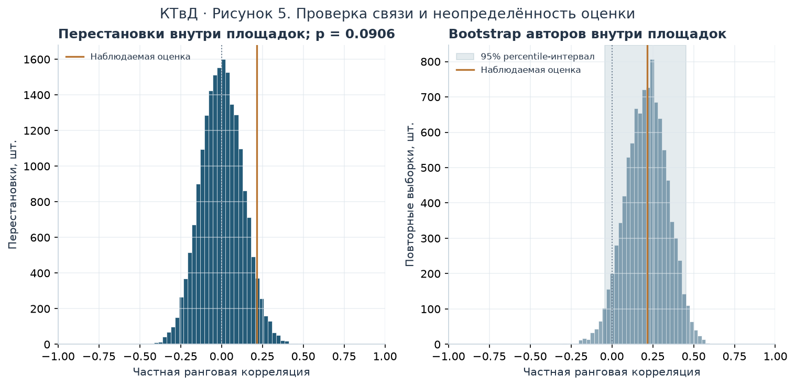

<a id="hw-top" name="hw-top"></a>

# Прикладная статистика. Дополнительное задание КТвД
## Ширина и высота рукописной буквы a

**Авторы:**  
Янковская Катерина — ИСУ 409951  
Шерстнев Игорь — ИСУ 504632

[1. Данные](#hw-data) · [2. Величины и случайность](#hw-variables) · [3. EDA](#hw-eda) · [4. Связь](#hw-association) · [5. Выводы](#hw-conclusions) · [6. Источники](#hw-sources)

[Ноутбук с расчётами](handwriting.ipynb) · [Основная лабораторная работа](https://github.com/EastC0ast/lab01/tree/design-layout)


<a id="hw-data" name="hw-data"></a>

## 1 · Данные и отбор

Использован [UJI Pen Characters (Version 2), UCI](https://archive.ics.uci.edu/dataset/177/uji+pen+characters+version+2), DOI [10.24432/C5FG8S](https://doi.org/10.24432/C5FG8S), лицензия CC BY 4.0. Исходный набор содержит 11 640 принятых записей 97 знаков от 60 авторов. Записи представляют собой траектории пера на планшете.

Для анализа выбрана строчная **латинская** буква `a`. В выборку вошли все 120 её записей: по два повторения каждого автора. Пропусков и нулевых размеров нет; выбросы не удалялись.

Площадки сбора: UJI — 16 авторов и 32 записи; UPV — 44 автора и 88 записей. В документации указаны разные масштабы: **100 ink units/мм у UJI и 152 ink units/мм у UPV**. Координаты переведены в миллиметры экранной системы планшета. Размер и ориентация исходных траекторий сохранены; сглаживание не применялось.

[Таблица измерений](data/glyphs.csv) содержит ширину и высоту каждой записи, автора, площадку и номер повторения.


<a id="hw-variables" name="hw-variables"></a>

## 2 · Две величины и природа случайности

Случайный опыт: равновероятно выбрать одного из 60 авторов, затем одно из двух его повторений. В наблюдаемой серии это эквивалентно равновероятному выбору одной из 120 записей. Величины:

- $W$ — ширина ограничивающего прямоугольника траектории, мм;
- $H$ — высота того же прямоугольника, мм.

Для автора $i$, повторения $j$ и площадки $s$ берутся все точки всех штрихов:


```math
W_{ij}=\frac{\max_k x_{ijk}-\min_k x_{ijk}}{c_s},\qquad
H_{ij}=\frac{\max_k y_{ijk}-\min_k y_{ijk}}{c_s},\qquad c_{UJI}=100,\ c_{UPV}=152.
```


Ширина и высота определяются разностью крайних координат по всем точкам всех штрихов.

Размеры зависят от почерка и конкретного движения пера: даже у одного автора два повторения различаются. Случайность опыта связана с выбором автора и повторения; формулы задают способ измерения выбранной траектории.


**Рисунок КТвД 1 · Примеры исходных траекторий.** Два повторения шести авторов, выбранных по равномерным позициям в отсортированном списке ID. Размеры панелей и масштаб в мм одинаковы; выполнен только перенос начала координат. Экранная ось Y направлена вниз. Синий — UJI, охра — UPV.




<a id="hw-eda" name="hw-eda"></a>

## 3 · Разведочный анализ

**Таблица КТвД 1 · Все 120 записей.** Значения округлены до трёх знаков. Для дисперсии и стандартного отклонения используется делитель $n-1$. Квантили вычислены линейной интерполяцией. В строке мод указаны все значения с наибольшей частотой.


Ширина изменяется от 1,842 до 10,046 мм, высота — от 2,408 до 9,987 мм. Средняя ширина равна 5,094 мм, средняя высота — 4,610 мм. На гистограммах виден правый хвост и отдельные крупные знаки; такие записи сохранены в расчёте. Моды зависят от дискретности координат и не являются подбором теоретического закона.

У 60 из 60 авторов ширина двух повторений различается, у 60 различается высота. Медианы абсолютных различий равны соответственно 0,855 и 0,850 мм. Вариация есть и внутри одного автора.


<div>

<table border="1" class="dataframe">
<thead>
<tr style="text-align: right;">
<th></th>
<th>Показатель</th>
<th>Ширина W</th>
<th>Высота H</th>
</tr>
</thead>
<tbody>
<tr>
<th>0</th>
<td>Объём, записей</td>
<td>120</td>
<td>120</td>
</tr>
<tr>
<th>1</th>
<td>Сумма, мм</td>
<td>611,286</td>
<td>553,214</td>
</tr>
<tr>
<th>2</th>
<td>Среднее, мм</td>
<td>5,094</td>
<td>4,610</td>
</tr>
<tr>
<th>3</th>
<td>Медиана, мм</td>
<td>5,000</td>
<td>4,378</td>
</tr>
<tr>
<th>4</th>
<td>Минимум, мм</td>
<td>1,842</td>
<td>2,408</td>
</tr>
<tr>
<th>5</th>
<td>Максимум, мм</td>
<td>10,046</td>
<td>9,987</td>
</tr>
<tr>
<th>6</th>
<td>Стандартное отклонение, мм</td>
<td>1,377</td>
<td>1,224</td>
</tr>
<tr>
<th>7</th>
<td>Выборочная дисперсия, мм²</td>
<td>1,897</td>
<td>1,498</td>
</tr>
<tr>
<th>8</th>
<td>5-й перцентиль, мм</td>
<td>2,953</td>
<td>3,157</td>
</tr>
<tr>
<th>9</th>
<td>1-й квартиль, мм</td>
<td>4,155</td>
<td>3,794</td>
</tr>
<tr>
<th>10</th>
<td>3-й квартиль, мм</td>
<td>5,860</td>
<td>5,317</td>
</tr>
<tr>
<th>11</th>
<td>95-й перцентиль, мм</td>
<td>7,455</td>
<td>6,463</td>
</tr>
<tr>
<th>12</th>
<td>Квартильный размах, мм</td>
<td>1,706</td>
<td>1,523</td>
</tr>
<tr>
<th>13</th>
<td>Все моды, мм</td>
<td>3,408; 3,855; 4,099; 4,211; 4,454; 5,395</td>
<td>3,454; 4,750</td>
</tr>
</tbody>
</table>
</div>

**Рисунок КТвД 2 · Гистограммы и эмпирические функции распределения.** Границы столбцов выбраны правилом Фридмана—Диакониса. ECDF построены по исходным размерам без округления; ступени правосторонне непрерывны.


```math
\widehat F_n(t)=\frac{1}{n}\sum_{j=1}^n\mathbf 1\{Z_j\leq t\},\qquad Z\in\{W,H\}.
```




Два повторения одного человека могут быть зависимы из-за общего почерка. Поэтому 120 записей не считаются 120 независимыми авторами. Для проверки межавторской связи используется по одной паре средних на человека:


```math
\bar W_i=\frac{W_{i1}+W_{i2}}{2},\qquad\bar H_i=\frac{H_{i1}+H_{i2}}{2}.
```


**Таблица КТвД 2 · 60 пар авторских средних.** Средние ширина и высота рассчитаны по двум повторениям каждого автора.


<div>

<table border="1" class="dataframe">
<thead>
<tr style="text-align: right;">
<th></th>
<th>Показатель</th>
<th>Средняя ширина автора</th>
<th>Средняя высота автора</th>
</tr>
</thead>
<tbody>
<tr>
<th>0</th>
<td>Объём, авторов</td>
<td>60</td>
<td>60</td>
</tr>
<tr>
<th>1</th>
<td>Сумма, мм</td>
<td>305,643</td>
<td>276,607</td>
</tr>
<tr>
<th>2</th>
<td>Среднее, мм</td>
<td>5,094</td>
<td>4,610</td>
</tr>
<tr>
<th>3</th>
<td>Медиана, мм</td>
<td>4,992</td>
<td>4,526</td>
</tr>
<tr>
<th>4</th>
<td>Минимум, мм</td>
<td>2,237</td>
<td>3,055</td>
</tr>
<tr>
<th>5</th>
<td>Максимум, мм</td>
<td>8,188</td>
<td>8,553</td>
</tr>
<tr>
<th>6</th>
<td>Стандартное отклонение, мм</td>
<td>1,223</td>
<td>1,038</td>
</tr>
<tr>
<th>7</th>
<td>Выборочная дисперсия, мм²</td>
<td>1,495</td>
<td>1,077</td>
</tr>
<tr>
<th>8</th>
<td>5-й перцентиль, мм</td>
<td>3,214</td>
<td>3,239</td>
</tr>
<tr>
<th>9</th>
<td>1-й квартиль, мм</td>
<td>4,334</td>
<td>3,923</td>
</tr>
<tr>
<th>10</th>
<td>3-й квартиль, мм</td>
<td>5,669</td>
<td>5,037</td>
</tr>
<tr>
<th>11</th>
<td>95-й перцентиль, мм</td>
<td>7,284</td>
<td>5,953</td>
</tr>
<tr>
<th>12</th>
<td>Квартильный размах, мм</td>
<td>1,335</td>
<td>1,114</td>
</tr>
<tr>
<th>13</th>
<td>Все моды, мм</td>
<td>6,765</td>
<td>4,600; 5,036</td>
</tr>
</tbody>
</table>
</div>

**Рисунок КТвД 3 · Парные размеры.** Слева — все записи и соединённые повторы каждого автора, справа — 60 авторских средних. Оси обоих графиков имеют одинаковые пределы и единицы.




<a id="hw-association" name="hw-association"></a>

## 4 · Проверка связи с учётом площадки

Обе величины относятся к одной записи, поэтому их независимость заранее не предполагается. Сначала приведены описательные коэффициенты. Различия в составе участников и условиях площадок могут сохраняться даже после перевода шкал в мм.

Основная проверка относится к **средним размерам авторов**. $H_0$: средняя ширина и средняя высота условно независимы при фиксированной площадке, $\bar W\perp\bar H\mid S$; соответствие ширин и высот внутри каждой площадки обменно; выбранная статистика чувствительна к ранговой связи. Альтернатива — связь, нарушающая это предположение.

Всем 60 средним присваиваются ранги $R_i$ и $Q_i$; совпадения получают средний ранг. Из рангов вычитаются средние ранги своей площадки:


```math
u_i=R_i-\overline R_{s(i)},\qquad v_i=Q_i-\overline Q_{s(i)},\qquad
r_{rank\mid S}=\frac{\sum_i u_i v_i}{\sqrt{\sum_i u_i^2\sum_i v_i^2}}.
```


Высоты авторов переставляются только внутри UJI и внутри UPV, ширины остаются на месте. При $B=19999$ двустороннее Monte Carlo p вычисляется с поправкой для конечного числа перестановок:


```math
p_{MC}=\frac{1+\#\{|r^{(b)}|\geq |r_{obs}|\}}{B+1}.
```


Для 95% percentile bootstrap-интервала 10 000 раз выбираются с возвращением целые пары авторских средних отдельно внутри площадок. Числа авторов 16 и 44 сохраняются; ранги пересчитываются заново. Интервал приближённый и рассчитан при сохранении состава выборки по площадкам.


**Таблица КТвД 3 · Коэффициенты связи и результаты проверки гипотезы.**

<div>

<table border="1" class="dataframe">
<thead>
<tr style="text-align: right;">
<th></th>
<th>Показатель</th>
<th>Значение</th>
</tr>
</thead>
<tbody>
<tr>
<th>0</th>
<td>Спирмен: исходные ink units, 60 авторов</td>
<td>0,462946</td>
</tr>
<tr>
<th>1</th>
<td>Спирмен: единые мм, 60 авторов</td>
<td>0,221446</td>
</tr>
<tr>
<th>2</th>
<td>Пирсон: единые мм, 60 авторов</td>
<td>0,228703</td>
</tr>
<tr>
<th>3</th>
<td>Частная ранговая корреляция с учётом площадки</td>
<td>0,214832</td>
</tr>
<tr>
<th>4</th>
<td>Двустороннее перестановочное p</td>
<td>0,0906</td>
</tr>
<tr>
<th>5</th>
<td>95% bootstrap-интервал</td>
<td>[-0,042782; 0,453239]</td>
</tr>
</tbody>
</table>
</div>

**Таблица КТвД 4 · Описательная чувствительность к площадке, единые мм.**

<div>

<table border="1" class="dataframe">
<thead>
<tr style="text-align: right;">
<th></th>
<th>Площадка</th>
<th>Авторы</th>
<th>Записи</th>
<th>Спирмен</th>
</tr>
</thead>
<tbody>
<tr>
<th>0</th>
<td>UJI</td>
<td>16</td>
<td>32</td>
<td>0,402798</td>
</tr>
<tr>
<th>1</th>
<td>UPV</td>
<td>44</td>
<td>88</td>
<td>0,170901</td>
</tr>
</tbody>
</table>
</div>

**Рисунок КТвД 4 · Влияние масштаба.** Без пересчёта единиц pooled-корреляция Спирмена равна 0,463, после пересчёта — 0,221. Сравнение исходных ink units смешивало разные шкалы и завышало видимую связь. Перевод единиц учитывает разницу масштабов; при проверке связи также учитывается площадка.




**Рисунок КТвД 5 · Перестановочная проверка и bootstrap.** Частная ранговая оценка равна 0,214832. Более экстремальных перестановок — 1811 из 19999; p = 0,0906. Оценка Monte Carlo стандартной ошибки p составляет около 0,0020.


При $\alpha=0,05$ нулевая гипотеза **не отвергается**. Данный ранговый тест не дал достаточных оснований против условной независимости внутри площадок. **Независимость не доказана**: возможны другие виды связи и недостаточная точность выборки из 60 авторов. Интервал [-0,042782; 0,453239] включает ноль.




<a id="hw-conclusions" name="hw-conclusions"></a>

## 5 · Выводы и ограничения

1. Для одинаковой буквы размеры не фиксированы: средние по всем записям составили 5,094 мм по ширине и 4,610 мм по высоте. Различия есть между авторами и между двумя повторениями одного автора.
2. При объединении рукописных данных сначала нужно согласовать единицы. Разные масштабы площадок заметно увеличивали наблюдаемую корреляцию. После документированного пересчёта и учёта площадки оценка связи слабая: 0,215, p = 0,0906.
3. При уровне 0,05 статистически значимая ранговая связь **между средними размерами авторов** не обнаружена. Это не равносильно доказанной независимости ширины и высоты отдельных букв.
4. Все описательные числа относятся к 120 принятым записям `a` данного набора. Авторы не описаны как случайная выборка населения. P-value и интервал требуют условной обменности/независимости участников внутри площадок; bootstrap не устраняет ограничение способа набора людей.
5. Участники писали в направляющих рамках и могли переделывать неудачные записи. Поэтому результаты относятся к принятым записям на планшете, а не к свободному письму на бумаге. Данных о времени и давлении нет, и эти характеристики не исследовались.


<a id="hw-sources" name="hw-sources"></a>

## 6 · Источники

1. Prat F., Castro M., Llorens D., Marzal A., Vilar J. **UJI Pen Characters (Version 2)**. UCI Machine Learning Repository, 2008. [DOI: 10.24432/C5FG8S](https://doi.org/10.24432/C5FG8S). Данные используются по [CC BY 4.0](https://creativecommons.org/licenses/by/4.0/); изменения — отбор `a`, расчёт размеров и перевод в мм.
2. Llorens D. et al. **The UJIpenchars Database: a Pen-Based Database of Isolated Handwritten Characters**. LREC, 2008. [Первичная статья](https://aclanthology.org/L08-1467/).
3. SciPy. [Перестановочные проверки, парные перестановки и Monte Carlo поправка](https://docs.scipy.org/doc/scipy/reference/generated/scipy.stats.permutation_test.html).

[Данные](data/glyphs.csv) · [Средние по авторам](data/writer_means.csv)

[К оглавлению](#hw-top) · [Основная лабораторная работа](https://github.com/EastC0ast/lab01/tree/design-layout)
